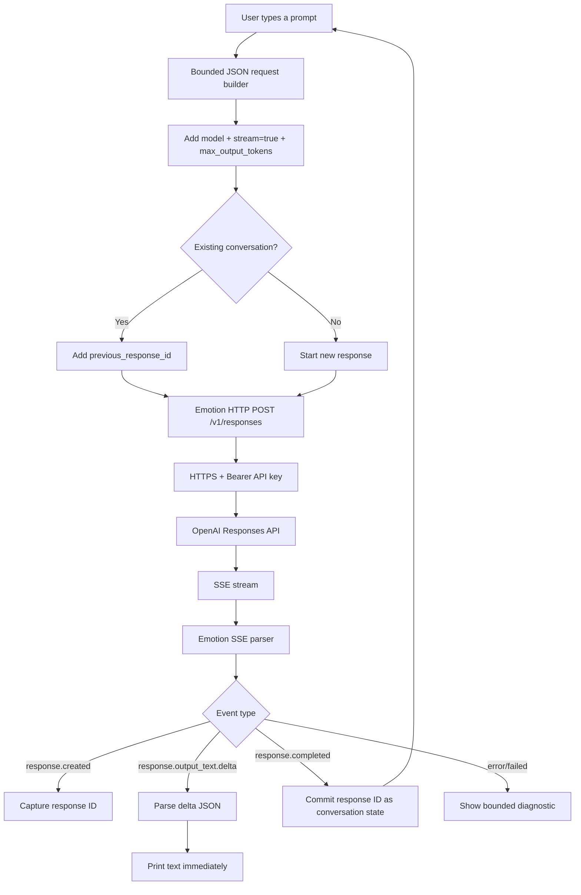

# Emotion Chat

A low-memory OpenAI chat client for **Emotion Linux**, designed for the PlayStation 2 R5900 and built on top of Emotion SDK 0.9+.

Emotion Chat uses the OpenAI **Responses API** and streams generated text over **Server-Sent Events (SSE)**. It is intentionally terminal-first, single-process and bounded so the same application architecture can move from Linux/x86_64 development to Emotion Linux on the PlayStation 2.

## What it does

- Interactive terminal chat and one-shot prompts.
- OpenAI Responses API over HTTPS.
- Incremental SSE processing through `Emotion::http`.
- Incremental JSON parsing through `Emotion::data`.
- Bearer authentication through `Emotion::auth`.
- Conversation continuation with `previous_response_id`.
- Configurable model and output-token ceiling.
- No API key stored in the repository or binary.
- Bounded request, SSE and parser buffers.

The default model is `gpt-6-luna`, selected for a lightweight client. Override it with `EMOTION_CHAT_MODEL`.

## How it works



The application never buffers the complete model response. Output text is printed as `response.output_text.delta` events arrive.

## Dependencies

- C17 compiler
- CMake 3.20+
- Emotion SDK >= 0.9
- An OpenAI API key

Public Emotion SDK targets used:

- `Emotion::core`
- `Emotion::http`
- `Emotion::data`
- `Emotion::auth`
- `Emotion::ui`

## Configure

Set your OpenAI API key in the environment:

```sh
export OPENAI_API_KEY="sk-..."
```

Do **not** commit the key to this repository.

Optional configuration:

```sh
export EMOTION_CHAT_MODEL="gpt-6-luna"
export EMOTION_CHAT_MAX_OUTPUT_TOKENS="1024"
```

For development against a compatible proxy or controlled test endpoint, the complete Responses endpoint can be overridden:

```sh
export EMOTION_CHAT_ENDPOINT="https://api.openai.com/v1/responses"
```

## Build

Install Emotion SDK 0.9+ into a prefix first. For an SDK installed under `$HOME/.local`:

```sh
cmake -S . -B build \
  -DCMAKE_BUILD_TYPE=MinSizeRel \
  -DCMAKE_PREFIX_PATH="$HOME/.local"
cmake --build build -j
```

Run tests:

```sh
ctest --test-dir build --output-on-failure
```

## Run

### Interactive chat

```sh
./build/emotion-chat
```

Commands inside the client:

```text
/help    show commands
/new     forget the current response chain and start a new chat
/quit    exit
```

### One-shot prompt

```sh
./build/emotion-chat "Explain what the Emotion Engine is in three sentences"
```

After installation into Emotion Linux:

```sh
emotion-chat
```

## Low-memory behavior

Emotion Chat deliberately avoids:

- buffering the complete API response;
- keeping a local unbounded conversation transcript;
- a JSON DOM;
- multi-process architecture;
- embedding an OpenAI language SDK.

Conversation state is represented by a bounded response ID. The OpenAI API retains the server-side response chain while the client only keeps the identifier required to continue it.

The request builder also imposes fixed prompt and output limits so a malformed input or response cannot grow memory indefinitely.

## Security

- `OPENAI_API_KEY` is read from the environment.
- The key is sent only in the HTTPS `Authorization: Bearer ...` header.
- TLS certificate/hostname validation is delegated to Emotion SDK.
- The API key is never written to logs or persistent storage by the MVP.
- Production Emotion Linux must provide a valid CA bundle supported by Emotion SDK.

## Target

Development starts on Linux/x86_64. Production target is Emotion Linux / `mipsr5900el` Linux o32 on the PlayStation 2.

On PS2 the same application code is expected to use the SDK's static-first Mbed TLS backend.

## API compatibility

The client targets the OpenAI Responses API at:

```text
POST https://api.openai.com/v1/responses
```

Streaming is requested with `"stream": true`. The primary text event consumed by the client is `response.output_text.delta`; successful completion is marked by `response.completed`.

## CI note

`Emotion-SDK` is currently private. Cross-repository GitHub Actions should only be enabled after an explicit read credential for the private SDK repository is configured.
